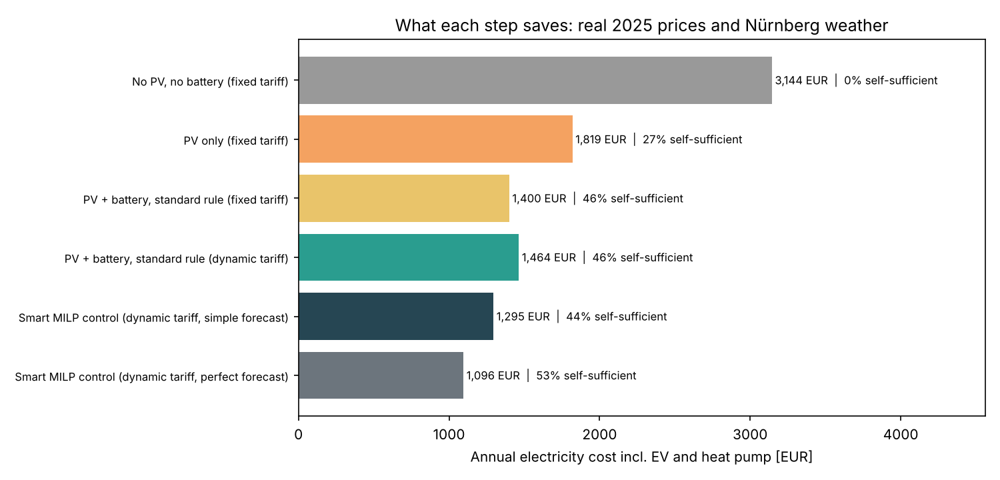
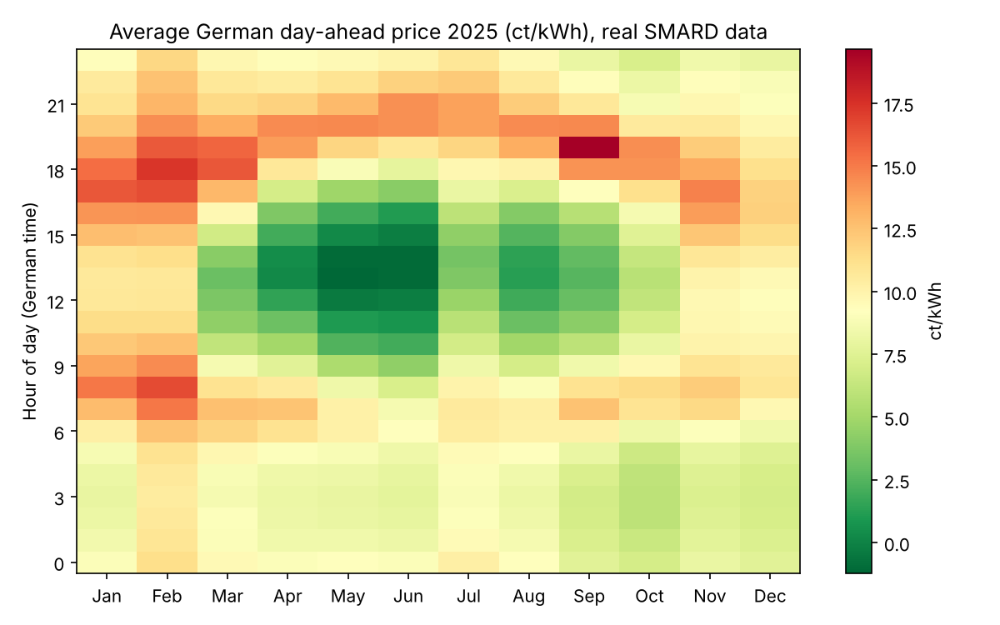
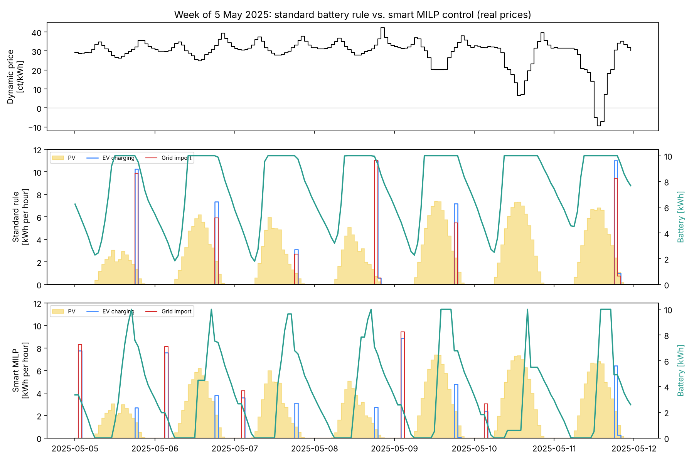
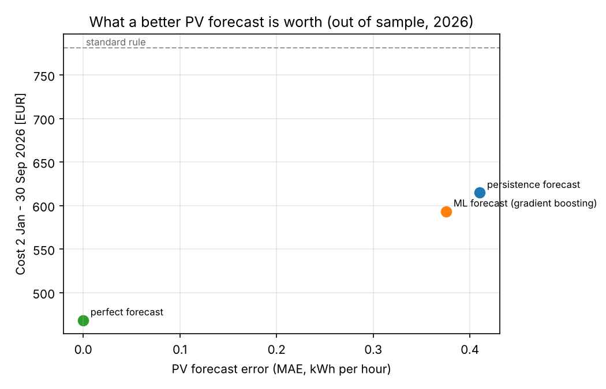

# Home Energy Optimizer – Smart Battery & EV Charging on Real German Electricity Prices

When should a household with solar panels, a home battery, a heat pump and an electric car charge, discharge,
buy and sell electricity? This project answers it with **real 2025–2026 German day-ahead prices** (SMARD,
Bundesnetzagentur) and **real Nürnberg weather** (Open-Meteo). It compares the standard "self-consumption"
battery rule that most home batteries use today with a **rolling mixed-integer optimizer (MILP)** that plans
every day at 13:00, when the next day's prices are published.

**Main findings (12 months of real 2025 prices):**
- Switching to a dynamic tariff **without** smart control made the household **pay 64 EUR more** per year.
- Smart MILP control with a simple forecast saved **105 EUR/year (7.5%)** compared with the standard battery rule on a fixed tariff, and **169 EUR (11.5%)** compared with the same dynamic tariff controlled by the rule.
- With perfect forecasts, the saving would be **304 EUR/year (22%)**, so better PV and load forecasts are worth up to **~200 EUR per household per year**.
- On unseen 2026 data, a machine-learning PV forecast (gradient boosting) cut cost by a further **3.5%** compared with a simple forecast.



## Data

| Source | What | Period |
|---|---|---|
| [SMARD.de](https://www.smard.de) (Bundesnetzagentur) | Hourly day-ahead prices, bidding zone Germany/Luxembourg | Jan 2025 – Sep 2026 |
| [Open-Meteo](https://open-meteo.com) historical weather API | Hourly temperature, solar irradiance (GHI) and cloud cover for Nürnberg | Jan 2025 – Sep 2026 |

Prices in 2025 averaged **8.9 ct/kWh** and ranged from **−25 to +58 ct/kWh**, with **573 hours of negative prices**,
mostly at sunny spring and summer middays. The daily pattern is clear: cheap at midday from April to September,
expensive in the morning and evening, and especially in winter evenings.



Both sources are timestamped differently: SMARD uses German local time with daylight saving time, and Open-Meteo a fixed
UTC+1 offset with each value averaging the *preceding* hour. Both are converted to UTC interval start times and
joined, giving 15,309 aligned hours.

## The household

No public smart meter data exists for a single household, so the household is **modelled from the real weather**:

| Component | Model | Annual energy (2025) |
|---|---|---|
| PV, 10 kWp | Irradiance × size × 0.90 performance factor, with −0.4%/°C temperature losses | 11,070 kWh (1,107 kWh/kWp) |
| Base load | Weekday/weekend daily profile, +15% in winter, random variation | 3,500 kWh |
| Heat pump | Heat demand from degree-hours below 15 °C plus hot water; COP = 45% of Carnot at 40 °C supply | 3,460 kWh electricity |
| EV | Home 18:00–07:00; 3–14 kWh needed on weekdays, 0 or 12 kWh on weekends; 11 kW wallbox | 2,560 kWh |
| Battery | 10 kWh, 5 kW, ~90% round-trip efficiency, 2 ct/kWh wear cost | – |

**Tariffs:** fixed tariff 33 ct/kWh; dynamic tariff = (spot price + 17 ct for grid fees, taxes, levies and
margin) + 19% VAT, which averaged 30.9 ct/kWh in 2025. Feed-in pays 7.9 ct/kWh (EEG, ≤ 10 kWp), and **nothing in
hours with negative prices**, as required for new systems under the 2025 *Solarspitzengesetz*.

## Control strategies

**Standard rule (self-consumption).** The EV charges at full power when plugged in. PV covers the house first,
then the EV, and surplus charges the battery. The battery discharges to cover the house. This is how most home
batteries run today.

**Smart MILP control (model predictive control).** Every day at 13:00, the optimizer plans from now until the end
of tomorrow (≈ 35 hours) using the known day-ahead prices and forecasts of PV and load, then executes 24 hours of
the plan. When actual PV and load differ from the forecast, the battery follows its planned power within its limits
and the grid absorbs the difference.

```
min  Σ_t  buy_price[t]·buy[t] − sell_price[t]·sell[t] + wear·dis[t]  −  v_end·soc[T]

s.t. pv[t] − curt[t] + dis[t] + buy[t] = load[t] + ev[t] + ch[t] + sell[t]     energy balance
     soc[t] = soc[t−1] + η·ch[t] − dis[t]/η,   0 ≤ soc[t] ≤ 10 kWh               battery
     ch[t] ≤ 5·zb[t],   dis[t] ≤ 5·(1 − zb[t])                                    no charging and discharging at once
     buy[t] ≤ 30·zg[t], sell[t] ≤ 30·(1 − zg[t])                                  no buying and selling at once
     ev[t] ≤ 11·plugged[t],   Σ_{t ∈ session} ev[t] = need[session]               EV ready at 07:00
     zb[t], zg[t] ∈ {0, 1}
```

The binary variables matter when prices turn negative: without them, a pure LP would "burn" energy by charging and
discharging, or buying and selling, at the same time. `v_end` values energy left in the battery at the end of the
horizon. Each daily problem has about 320 variables (70 binary) and solves with HiGHS in milliseconds, so a full
year of 365 daily plans takes about 10 seconds.

**Forecasts** made at 13:00:
- **Perfect:** the actual values. This is an upper bound, not achievable in practice.
- **Persistence:** the same hour on the last observed day. This simple baseline is often hard to beat.
- **ML:** gradient boosting (scikit-learn) trained on 2025, using the calendar, recent PV, a clear-sky proxy (best PV at this hour over the last 14 days) and recent cloud cover. No weather forecast is used, because historical weather forecasts are not freely available.

## Results

### Part 1: one year of real prices (2 Jan 2025 – 2 Jan 2026)

| Strategy | Annual cost | Self-sufficiency | Avg. import price | Battery cycles | EV charged at night |
|---|---|---|---|---|---|
| No PV, no battery (fixed tariff) | 3,144 EUR | 0% | 33.0 ct | – | 0% |
| PV only (fixed tariff) | 1,819 EUR | 27% | 33.0 ct | – | 0% |
| PV + battery, standard rule (fixed tariff) | 1,400 EUR | 46% | 33.0 ct | 185 | 0% |
| PV + battery, standard rule (dynamic tariff) | 1,464 EUR | 46% | 34.3 ct | 185 | 0% |
| **Smart MILP (dynamic tariff, persistence forecast)** | **1,295 EUR** | 44% | **30.6 ct** | 286 | 64% |
| Smart MILP (dynamic tariff, perfect forecast) | 1,096 EUR | 53% | 30.6 ct | 287 | 63% |



### Part 2: what forecasting is worth (out of sample, 2 Jan – 30 Sep 2026)

The ML model is trained only on 2025 and tested on 2026.

| Strategy | Cost | PV forecast error (MAE) | Saving vs. standard rule |
|---|---|---|---|
| Standard rule (dynamic tariff) | 781 EUR | – | – |
| Smart MILP, persistence forecast | 615 EUR | 0.41 kWh/h | 21.3% |
| **Smart MILP, ML forecast** | **593 EUR** | **0.38 kWh/h** | **24.1%** |
| Smart MILP, perfect forecast | 468 EUR | 0 | 40.1% |



### Key insights

1. **A dynamic tariff alone is not enough.** With the standard rule, the household buys most of its grid power in
   the evening and in winter, exactly when spot prices are highest, so it paid 64 EUR more per year than on the fixed
   tariff. The tariff only pays off together with control that reacts to prices.
2. **The smart controller moves energy in time.** It charges the EV at night or at cheap hours instead of at 18:00,
   keeps the battery empty in the morning so it can charge at the cheapest midday hours instead of at 10:00, and
   charges from the grid before evening price peaks. Its average import price drops from 34.3 to 30.6 ct/kWh.
3. **Forecasts are worth real money.** The gap between a simple and a perfect forecast is about 200 EUR per household
   per year in 2025. With a simple forecast, the optimizer sometimes plans to charge from PV that never comes and buys
   at a bad moment instead; that is why its self-sufficiency is slightly *below* the standard rule.
4. **Machine learning helps, but weather forecasts would help more.** Without a weather forecast as input, gradient
   boosting improves the PV forecast error by about 8% and the cost by 3.5% (21 EUR in 9 months). Most of the remaining
   146 EUR gap to the perfect forecast can only be closed with numerical weather predictions.
5. **Negative prices are a real issue for solar owners.** Under the 2025 rules, new systems are not paid for feeding in
   during negative-price hours. With the standard rule, this household exported 2,350 kWh in those hours without payment.

## How to run

```bash
pip install -r requirements.txt
python src/run.py
```

All tables and figures are written to `results/`. The full run takes about 1 minute.

## Project structure

```
data/                       real input data (SMARD prices, Open-Meteo weather)
src/data.py                 data loading and time alignment, household model, tariffs
src/optimizer.py            MILP for one planning horizon (SciPy / HiGHS)
src/forecast.py             persistence and gradient boosting PV forecasts
src/simulate.py             standard rule and rolling MILP (model predictive control) simulation
src/run.py                  experiments, tables and plots
results/                    CSV outputs and figures
```

## Limitations and next steps

- **Household data is modelled, not measured.** Using real smart-meter data (for example a public dataset or one's own home) would make the savings more reliable.
- **No weather forecast input.** Adding numerical weather predictions (e.g. DWD ICON via Open-Meteo's forecast API, collected going forward) would close much of the forecast gap.
- **Heat pump not controlled.** The heat pump is a large flexible load; shifting it with the building as thermal storage is the natural next step.
- **Monthly fees and §14a grid fee discounts** for controllable devices are not included.
- **Since October 2025, the day-ahead market trades 15-minute products;** this model uses hourly averages.

## Data licences

Electricity price data: Bundesnetzagentur | SMARD.de, licensed under CC BY 4.0.
Weather data: Open-Meteo.com, licensed under CC BY 4.0.
